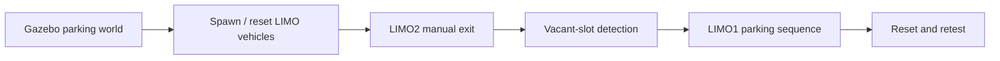

# YSM Validation Workspace

ROS 2 and Gazebo workspace used to integrate and repeatedly test a multi-vehicle remote-parking scenario with LIMO-scale Ackermann vehicles.

> Development-stage simulation environment · ROS 2 Humble · Gazebo Classic

## Purpose

This repository preserves the development environment that preceded the team's final capstone system. It focuses on shared simulation setup, multi-vehicle spawning and reset, parking-node integration, and repeatable scenario execution.

The final team result is maintained separately in the SEA:ME@KOREA capstone repository. A cleaned publication copy will be linked here after upload.

## Scenario flow



## Workspace structure

| Package | Role |
| --- | --- |
| `limo_car` | LIMO meshes, URDF/Xacro, Ackermann model, and RViz settings |
| `limo_gazebosim` | Parking worlds, vehicle models, spawn/reset tools, and simulation launch support |
| `my_valet_parking` | Slot tracking, teleoperation, exit/evasion, and parking experiment nodes |
| `parking_pkg` | Integrated preparation and parking state-machine nodes |

## Preserved execution tools

| File | Confirmed behavior from source |
| --- | --- |
| `start_YSM.sh` | Builds the workspace when needed, starts Gazebo and robot state publishing, then spawns the LIMO vehicles |
| `src/my_valet_parking/scripts/run_parking_algorithm.sh` | Starts the slot tracker and valet-parking controller and stops both on exit |
| `src/my_valet_parking/my_valet_parking/limo2_arrow_teleop.py` | Publishes ramp-limited keyboard commands for LIMO2 and blocks motion beyond configured soft boundaries |
| `src/limo_gazebosim/scripts/reset_limo_positions.sh` | Stops scenario nodes and calls `reset_limo.py` to respawn the vehicles without restarting Gazebo |

These files are retained because they appear together in the repository's recorded working-scenario commit. This does not establish sole authorship of every underlying package or algorithm.

## Build and start

Original environment:

- Ubuntu 22.04
- ROS 2 Humble
- Gazebo Classic
- Python 3 / `rclpy`

```bash
source /opt/ros/humble/setup.bash
cd ~/YSM_ws
colcon build --symlink-install
source install/setup.bash
./start_YSM.sh
```

After the simulation is ready, the integrated parking package can be launched with:

```bash
ros2 launch parking_pkg valet.launch.py
```

The alternative development launcher can be run with:

```bash
./src/my_valet_parking/scripts/run_parking_algorithm.sh
```

## Test record and limits

Git history records a working full-scenario checkpoint and a later Gazebo physics-iteration adjustment. The repository also preserves reset/retest tooling and parameterized slot detection.

The current machine runs Ubuntu 24.04 with ROS 2 Jazzy, not the original Humble environment. No new end-to-end execution result is claimed during this publication cleanup. A local, uncommitted slot-coordinate adjustment is retained as a working-copy change but has not been independently revalidated here.

## Source and attribution

This project was developed from existing ROS 2 and LIMO/Gazebo resources and then adapted for the team parking scenario. Package metadata and team history are preserved. See [THIRD_PARTY_NOTICES.md](THIRD_PARTY_NOTICES.md).

The presence of a file does not imply that the repository owner wrote the complete upstream implementation. Personal contribution claims should be limited to changes supported by project records.
